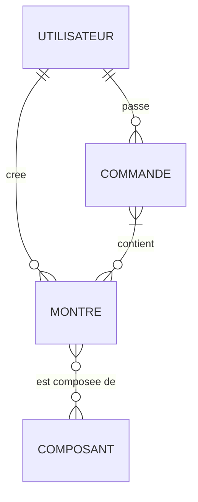
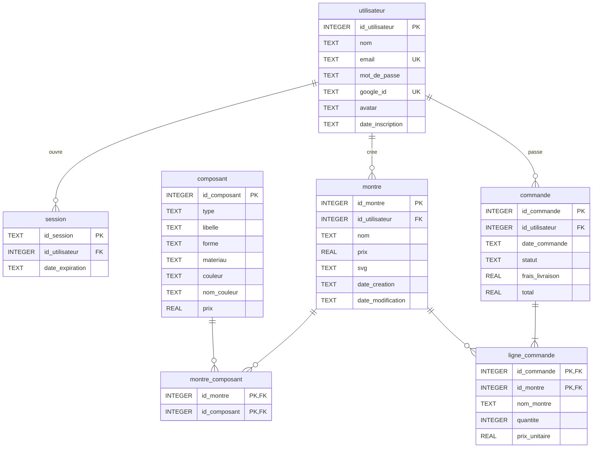

# TiK•TaK : modélisation des données

## 1. Dictionnaire des données

| Code | Signification | Type | Entité |
|---|---|---|---|
| id_utilisateur | Identifiant de l'utilisateur | Entier (auto) | UTILISATEUR |
| nom | Nom affiché | Texte | UTILISATEUR |
| email | Adresse e-mail (unique) | Texte | UTILISATEUR |
| mot_de_passe | Hash scrypt du mot de passe (vide si compte Google) | Texte | UTILISATEUR |
| google_id | Identifiant Google « sub » | Texte | UTILISATEUR |
| avatar | URL de la photo de profil | Texte | UTILISATEUR |
| date_inscription | Date de création du compte | Date | UTILISATEUR |
| id_montre | Identifiant unique de la montre | Entier (auto) | MONTRE |
| nom | Nom de la montre | Texte | MONTRE |
| prix | Prix de la montre (79 € + composants) | Réel | MONTRE |
| svg | Rendu SVG de la montre | Texte | MONTRE |
| date_creation | Date de création | Date | MONTRE |
| date_modification | Date de dernière modification | Date | MONTRE |
| id_composant | Identifiant du composant | Entier (auto) | COMPOSANT |
| type | bracelet, cadran, boitier_exterieur, boitier_interieur | Texte | COMPOSANT |
| libelle | Libellé du composant | Texte | COMPOSANT |
| forme | rond ou carre (cadran) | Texte | COMPOSANT |
| materiau | Matériau | Texte | COMPOSANT |
| couleur | Couleur (hexadécimal) | Texte | COMPOSANT |
| nom_couleur | Nom commercial de la couleur | Texte | COMPOSANT |
| prix | Prix du composant | Réel | COMPOSANT |
| id_commande | Identifiant de la commande | Entier (auto) | COMMANDE |
| date_commande | Date de la commande | Date | COMMANDE |
| statut | validee, expediee, livree, annulee | Texte | COMMANDE |
| frais_livraison | Frais de livraison (10 €) | Réel | COMMANDE |
| total | Total payé | Réel | COMMANDE |
| quantite | Quantité commandée | Entier | CONTENIR (association) |
| prix_unitaire | Prix de la montre au moment de l'achat | Réel | CONTENIR (association) |

## 2. MCD (Merise)

```
UTILISATEUR (id_utilisateur, nom, email, mot_de_passe, google_id, avatar, date_inscription)
MONTRE      (id_montre, nom, prix, svg, date_creation, date_modification)
COMPOSANT   (id_composant, type, libelle, forme, materiau, couleur, nom_couleur, prix)
COMMANDE    (id_commande, date_commande, statut, frais_livraison, total)

UTILISATEUR 0,n ── CRÉER ──────────── 1,1 MONTRE
UTILISATEUR 0,n ── PASSER ─────────── 1,1 COMMANDE
MONTRE      0,n ── ÊTRE COMPOSÉE DE ── 0,n COMPOSANT
COMMANDE    1,n ── CONTENIR (quantite, prix_unitaire) ── 0,n MONTRE
```

Lecture des cardinalités :
- un utilisateur crée de 0 à n montres ; une montre est créée par un et un seul utilisateur ;
- un utilisateur passe de 0 à n commandes ; une commande est passée par un seul utilisateur ;
- une montre est composée de 0 à n composants (0 pour un brouillon), et un même composant peut être utilisé dans 0 à n montres ;
- une commande contient au moins une montre ; une montre peut apparaître dans 0 à n commandes.



## 3. MLD / MPD (relationnel)

- **utilisateur** (<u>id_utilisateur</u>, nom, email, mot_de_passe, google_id, avatar, date_inscription)
- **session** (<u>id_session</u>, #id_utilisateur, date_expiration) *(table technique pour l'authentification)*
- **composant** (<u>id_composant</u>, type, libelle, forme, materiau, couleur, nom_couleur, prix)
- **montre** (<u>id_montre</u>, #id_utilisateur, nom, prix, svg, date_creation, date_modification)
- **montre_composant** (<u>#id_montre, #id_composant</u>)
- **commande** (<u>id_commande</u>, #id_utilisateur, date_commande, statut, frais_livraison, total)
- **ligne_commande** (<u>#id_commande, #id_montre</u>, nom_montre, quantite, prix_unitaire)



Le script SQL complet est dans `database/schema.sql`, le jeu de données dans `database/seed.sql`, la base dans `database/tiktak.sqlite`.

### Choix de modélisation
- Le **prix unitaire** est recopié dans `ligne_commande` : si l'utilisateur modifie sa montre après l'avoir commandée, l'historique d'achat reste juste.
- Une montre déjà commandée ne peut pas être supprimée (`ON DELETE RESTRICT`), pour garder l'historique.
- Le **SVG** de chaque montre est stocké en base, comme le demande le sujet.
- Le **cadran** porte la forme (rond ou carré) : c'est lui qui fait basculer le SVG entre le boîtier carré et le boîtier rond.
